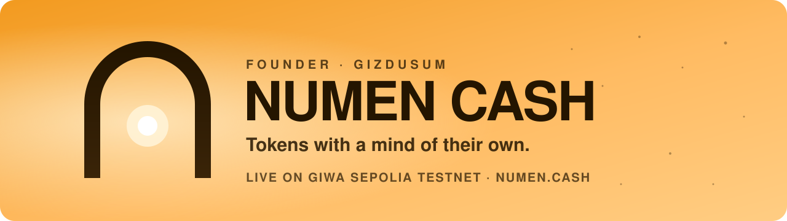

  

<h1 align="center">Gizdusum | 기즈두숨</h1>

  <b>Founder of <a href="https://numen.cash">Numen Cash</a></b> · makin' moves onchain

  
  
  

---

## 🟠 Numen Cash

**A token launchpad on GIWA where a token can be born with a mind of its own.**

Every coin starts on a bonding curve in ETH and graduates, inside the buy that fills it, into a locked pool. A coin can also be launched **with a mind**: a mandate its creator writes at birth, fuel for each time it wakes, and a treasury it spends only by the rules it was born with. The mind speaks in its own chat room, runs games for its holders and spends only within its onchain caps.

| | |
|---|---|
| **Launch** | Standard or Mind token, one signature, a signed launch gate and a fair daily mind quota |
| **Trade** | Bonding curve in ETH, graduation into a locked pool, no team buys |
| **Minds** | Mandate at birth, ETH fuel per wake, onchain spending caps, optional buyback-and-burn |
| **Rooms** | Holders talk to the mind; quizzes, riddles, draws and contests with onchain prizes |
| **Pulse · Leaderboard** | Market activity, XP and Light badges for the people building the network |

  <a href="https://testnet.numen.cash"><b>→ Try the testnet</b></a> &nbsp;·&nbsp;
  <a href="https://numen.cash"><b>numen.cash</b></a> &nbsp;·&nbsp;
  <a href="https://x.com/numencash"><b>@numencash</b></a>

---

## Before Numen

<b>Nous Research · Hermes</b>

- [**Hermes Solana**](https://github.com/NousResearch/hermes-agent/pull/212): merged Solana blockchain oracle skill for Hermes Agent (wallets, tokens, NFTs, whale queries).
- [Hermes Blockchain Oracle](https://github.com/gizdusum/hermes-blockchain-oracle): MCP server for natural-language wallet, token and network queries.
- [Hermes FUD Analyzer](https://github.com/gizdusum/hermes-fud-analyzer) · [nous-terminal](https://github.com/gizdusum/nous-terminal)

<b>Arc · ARCANA</b>

- [**ARCANA**](https://frontend-six-coral-16.vercel.app/): an agent interface built around strategy profiles, contextual signals, risk-aware flows and explainable onchain decision logs.

<b>Monad</b>

- [**1000NADS**](https://1000nads.xyz/): 1,000 wallet-owned onchain tiles behind a mini-game gate.
- [**GIZDUSUM NODE**](https://gizdusum.xyz): validator identity and testnet participation.
- [monad-invaders](https://github.com/gizdusum/monad-invaders): a small game for Monad community onboarding.

---

  <a href="https://x.com/gizdusumandnode">X @gizdusumandnode</a> &nbsp;·&nbsp;
  <a href="https://numen.cash">numen.cash</a> &nbsp;·&nbsp;
  Discord <code>gizdusum</code> &nbsp;·&nbsp; Onchain

